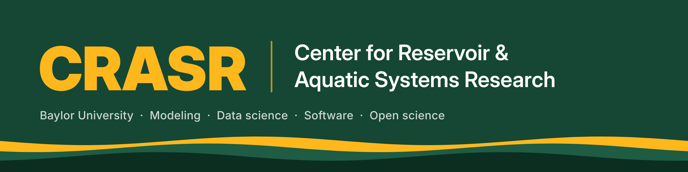

<picture>
  <source media="(prefers-color-scheme: dark)" srcset="https://raw.githubusercontent.com/CRASR/.github/main/assets/banner/banner-dark.png">
  
</picture>

The **Center for Reservoir and Aquatic Systems Research (CRASR)** at Baylor University studies reservoirs, rivers, and the aquatic ecosystems that supply water to people and the environment. This organization holds the center's open code: the models, data pipelines, and software that turn field and laboratory measurements into usable data and defensible answers.

### What we build

- **Process-based models.** Mechanistic models of reservoir, stream, and ecosystem processes, used to test ideas and explore management scenarios.
- **Statistical models.** Bayesian and hierarchical models that estimate water-quality and ecosystem dynamics with honest uncertainty.
- **Machine learning.** Predictive models for large, messy environmental datasets, built to complement process understanding rather than replace it.
- **Data infrastructure.** Pipelines and databases for sensor, logger, and laboratory data, with automated QA/QC and reporting.
- **Software.** R packages, apps, and tools that support the center's field, lab, and analysis work.
- **Open science.** Reproducible workflows, documented code, and shared data and methods.

### Find out more

- **[crasr.github.io](https://crasr.github.io)**: projects, tools, and capabilities
- **[CRASR at Baylor](https://crasr.artsandsciences.baylor.edu)**: the center, its people, and its analytical services
- **[Contact](https://crasr.artsandsciences.baylor.edu/contact-us)**: Baylor Sciences Building, Waco, Texas

CRASR is a research and education partnership between Baylor University and the City of Waco.
